<div align="center">



<br/><br/>

[](https://github.com/e12jassir/kickoff-cli/releases)
[](https://github.com/e12jassir/kickoff-cli/stargazers)
[](https://go.dev)
[](#install)
[](LICENSE)

<br/>

**[Quick start](#quick-start)** &nbsp;·&nbsp; **[Features](#features)** &nbsp;·&nbsp; **[Gallery](#gallery)** &nbsp;·&nbsp; **[Install](#install)** &nbsp;·&nbsp; **[Keybindings](#keybindings)** &nbsp;·&nbsp; **[Competitions](#competitions)**

<br/>

<!-- Tip: swap this screenshot for a 10-second demo GIF (assets/demo.gif) -->


</div>

<br/>

## ⚡ Quick start

**🐧 Linux &nbsp;/&nbsp; 🍏 macOS**

```bash
curl -fsSL https://raw.githubusercontent.com/e12jassir/kickoff-cli/main/install.sh | bash
kickoff
```

**🪟 Windows (PowerShell)**

```powershell
powershell -c "irm https://raw.githubusercontent.com/e12jassir/kickoff-cli/main/install.ps1 | iex"
kickoff
```

Pick a competition, pick a match, press <kbd>Enter</kbd>. That's the whole tutorial.

<br/>

## ✨ Features

| | |
| :-- | :-- |
| **⚡ Instant**<br/><sub>Native Go binary. Millisecond startup, around 28 MB of RAM.</sub> | **🔴 Live scores**<br/><sub>Running match clock and live indicators, auto-synced every 15 seconds.</sub> |
| **⏱️ Event timeline**<br/><sub>Goals, penalties, cards and substitutions on a centered vertical timeline.</sub> | **📊 Team stats**<br/><sub>Possession bar, shots, passing accuracy, corners and discipline.</sub> |
| **📋 Lineups**<br/><sub>Starting XIs, formations, squad numbers and substitute benches.</sub> | **▶️ Playback in mpv**<br/><sub>Launch a channel with one keystroke, using the sources you configure.</sub> |
| **⌨️ Keyboard-first**<br/><sub>`hjkl` or arrows, number keys for tabs, one key to refresh.</sub> | **🔒 Private**<br/><sub>No account. No telemetry. Nothing but football on your screen.</sub> |

Plus `kickoff update` to self-update and `kickoff setup` to diagnose your system.

<br/>

## 📸 Gallery

<div align="center">

| 🏆 Competition hub | ⏱️ Event timeline |
| :---: | :---: |
|  |  |

| 📊 Team stats | 📋 Lineups |
| :---: | :---: |
|  |  |

</div>

<br/>

## 📦 Install

**🐧 Linux &nbsp;/&nbsp; 🍏 macOS**

```bash
curl -fsSL https://raw.githubusercontent.com/e12jassir/kickoff-cli/main/install.sh | bash
```

Installs to `~/.local/bin` and sets up `mpv` and an emoji font if they're missing. If `kickoff` isn't found afterwards, add that folder to your `PATH`.

**🪟 Windows**

One-line installer via **PowerShell**:

```powershell
powershell -c "irm https://raw.githubusercontent.com/e12jassir/kickoff-cli/main/install.ps1 | iex"
```

Or download `kickoff_windows_amd64.zip` from [Releases](https://github.com/e12jassir/kickoff-cli/releases), extract it and double-click `Instalar-Kickoff.bat` (automatically installs portable `mpv` if missing and creates a branded desktop shortcut).

**🛠️ From source**

```bash
git clone https://github.com/e12jassir/kickoff-cli.git && cd kickoff-cli && make install
```

> [!NOTE]
> **mpv is optional** and only needed for playback. Scores, stats and lineups work without it. On Windows: `winget install mpv.net`, `scoop install mpv` or `choco install mpv`.

<br/>

## ⌨️ Keybindings

| Key | Action | | Key | Action |
| :-- | :-- | :-: | :-- | :-- |
| <kbd>↑</kbd> <kbd>↓</kbd> / <kbd>k</kbd> <kbd>j</kbd> | Move | | <kbd>r</kbd> | Refresh |
| <kbd>Enter</kbd> | Open match · launch channel | | <kbd>u</kbd> | Update when available |
| <kbd>1</kbd> <kbd>2</kbd> <kbd>3</kbd> | Timeline · Stats · Lineups | | <kbd>Esc</kbd> | Back |
| <kbd>←</kbd> <kbd>→</kbd> / <kbd>h</kbd> <kbd>l</kbd> | Previous / next tab | | <kbd>q</kbd> | Quit |

```text
kickoff            Open the match explorer
kickoff bar        Status bar & prompt integration (plain, tmux, waybar, starship)
kickoff update     Update to the latest release
kickoff setup      Check mpv, fonts, config and cache
kickoff version    Print the version
```

### 📊 Status Bar & Shell Integration

Display live scores in your terminal prompt, status bar or window manager:

```bash
# Plain text (scripts, Polybar, conky)
kickoff bar -f plain

# Tmux statusline (Linux, macOS, WSL)
kickoff bar -f tmux

# Waybar (Linux Hyprland / Sway JSON protocol)
kickoff bar -f waybar

# Starship prompt / Oh My Posh
kickoff bar -f starship

# Continuous daemon mode with desktop notifications on goals
kickoff bar --watch --notify
```


<br/>

## 🏆 Competitions

| | |
| :-- | :-- |
| 🌍 **International** | Champions League · Copa Libertadores |
| 🇪🇺 **Europe** | Premier League · La Liga · Serie A · Bundesliga · Ligue 1 |
| 🌎 **South America** | Liga BetPlay · Liga Profesional · Brasileirão |

Missing your league? [Open an issue](https://github.com/e12jassir/kickoff-cli/issues). Custom playback sources and advanced options are in [`docs/configuration.md`](docs/configuration.md).

<br/>

## 🤝 Contributing

Bug reports, leagues, ideas and pull requests are welcome. Run `make test` before sending one.

If kickoff makes your matchday better, a ⭐ helps other fans find it.

<br/>

## ⚖️ Disclaimer

kickoff is independent and **not affiliated with** ESPN, any league, club or broadcaster. Match data comes from public endpoints. kickoff does not host or redistribute video: playback only hands a URL to your local `mpv`. You are responsible for the sources you use and for following the laws that apply where you live.

<br/>

<div align="center">

**MIT** © [Esteban David Marrugo Jassir](https://github.com/e12jassir)

<sub>Made with ⚽ and Go</sub>

</div>
