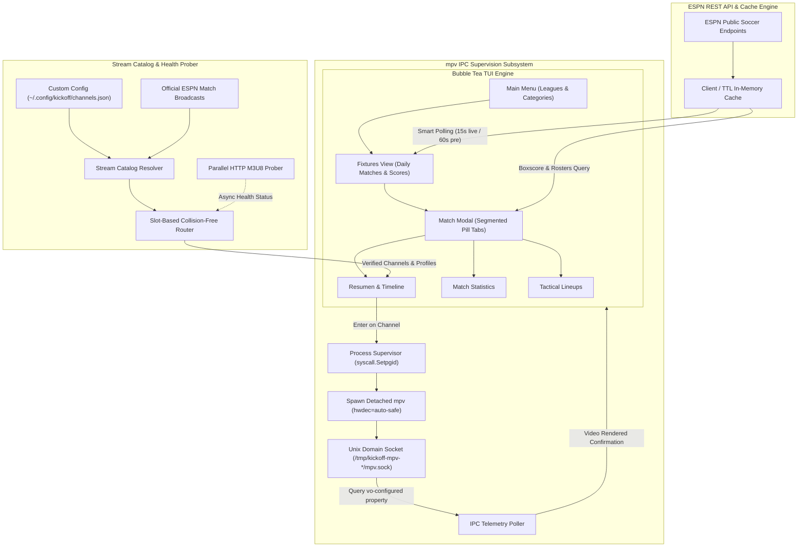

<div align="center">

# kickoff-cli `v3.0.0`
### Bubble Tea Edition

**An elegant, lightning-fast terminal soccer client and live broadcast launcher for Linux and Wayland.**

[](https://go.dev/)
[](https://www.kernel.org/)
[](https://github.com/charmbracelet/bubbletea)
[](https://mpv.io/)
[](LICENSE)

---

</div>

## Overview

**kickoff-cli** is a high-performance terminal football application built for soccer enthusiasts who demand real-time data, distraction-free navigation, and immediate stream access without browser bloat or advertisements.

Powered by Charm's [Bubble Tea](https://github.com/charmbracelet/bubbletea) and [Lip Gloss](https://github.com/charmbracelet/lipgloss), `kickoff` connects directly to official live sports endpoints to deliver real-time scores, in-game match clocks, centered vertical event timelines, detailed match statistics, and tactical lineups. When you are ready to watch, an intelligent multi-channel stream resolver pairs fixtures with verified, healthy live streams and launches them via hardware-accelerated `mpv` supervised over a Unix domain IPC socket.

---

## Visual Showcase

<div align="center">

| League Selection Menu | Daily Fixtures & Live Scores |
| :---: | :---: |
|  |  |
| *Hierarchical competition menu categorized by continental tournaments, European leagues, and South American leagues.* | *Live daily fixtures with minute-by-minute clock, live pulsing indicators, and scheduled kick-off times.* |

| Match Modal & Timeline | In-Depth Match Statistics |
| :---: | :---: |
|  |  |
| *Centered vertical timeline featuring goals, cards, halftime dividers, and sanitized broadcast signals.* | *Comparative team metrics with dual-color possession bar, shots, passes, corners, and fouls.* |

| Tactical Lineups & Starting XI |
| :---: |
|  |
| *Tactical formations, starting XI rosters with squad numbers, and substitute benches.* |

</div>

---

## Core Features

### 1. Bubble Tea Interactive TUI
- **Keyboard-Driven Workflow**: Intuitive modal navigation using `hjkl` or arrow keys with quick tab jumping (`1`, `2`, `3`).
- **Responsive Layouts**: Dynamic window resizing support with automatic centering and clean modal overlays.
- **Segmented Modal Tabs**: Seamless switching between **Resumen** (timeline & broadcast channels), **Estadísticas** (possession, shots, passes, discipline), and **Alineaciones** (formations & starting XI).
- **Live Pulse Telemetry**: Real-time visual heartbeats (`● EN VIVO`) synchronized across match items and modal headers.

### 2. Collision-Free Multi-Channel Stream Resolver
- **Dynamic Slot Routing**: For simultaneous matches within the same competition, `kickoff` calculates unique slot indices, routing concurrent fixtures to independent signals (e.g., ESPN 1 through ESPN 7) to prevent channel collisions.
- **Strict Official Broadcast Matching**: Matches ESPN broadcast metadata directly against verified high-definition signals without heuristic guesswork.
- **Dedicated Colombian Coverage**: Out-of-the-box routing for Colombian domestic competitions with verified channels including **Caracol TV HD**, **Caracol HD2**, **Canal RCN HD**, **RCN HD2**, **Win Sports HD**, and **Win+ Fútbol**.
- **Protocol & CDN URL Sanitization**: Enforces strict URL safety checks and enforces HTTP for CDN hosts with known TLS handshake issues under FFmpeg/mpv.

### 3. Background Stream Health Prober
- **Asynchronous Playlist Validation**: A parallel worker pool performs lightweight byte-range HTTP `GET` requests (`bytes=0-512`) checking for valid `#EXTM3U` headers.
- **Zero UI Latency**: Stream health probing runs fully detached in the background without delaying startup or blocking user interaction.
- **Dynamic Prioritization**: Verified active feeds are prioritized automatically in channel selectors.

### 4. mpv IPC Telemetry & Hardware Playback
- **GPU-Accelerated Decoding**: Automatically invokes `mpv` with `--hwdec=auto-safe`, `--cache=yes`, and 120MB demuxer buffers for smooth playback.
- **Detached Process Management**: Launches playback in a dedicated process group (`Setpgid`), completely isolated from terminal stdin to prevent input bleed.
- **IPC Handshake Supervision**: Binds a secure Unix domain socket (enforcing `0700` directory permissions) and queries `vo-configured` property events. The TUI suppresses terminal noise and unblocks only after the first video frame renders.
- **Clean Signal Handling**: Gracefully handles interrupts and teardowns, ensuring background child processes are cleanly killed on exit.

### 5. Smart Adaptive Live Sync
- **State-Aware Polling**: Intelligent auto-sync intervals adjust dynamically:
  - **15 seconds**: When any match in the current league is live or within 15 minutes of kickoff.
  - **60 seconds**: Standard schedule browsing.
  - **5 minutes**: When all scheduled matches of the day are concluded.
- **Live Timeline Events**: Real-time capture of goals, penalty kicks, yellow cards, red cards, and own goals placed symmetrically along a centered time axis.

---

## Architecture

The diagram below illustrates the decoupled architecture between the Bubble Tea UI, ESPN data pipelines, stream resolution engine, and mpv process controller:



---

## Supported Competitions

`kickoff` natively tracks 10 premier domestic leagues and continental tournaments:

| Category | Competition | Emoji | ESPN Key |
| :--- | :--- | :---: | :--- |
| **Torneos Internacionales** | UEFA Champions League | 🏆 | `uefa.champions` |
| | Copa Libertadores | 🌎 | `conmebol.libertadores` |
| **Ligas Europeas** | Premier League | 🏴󠁧󠁢󠁥󠁮󠁧󠁿 | `eng.1` |
| | La Liga | 🇪🇸 | `esp.1` |
| | Serie A | 🇮🇹 | `ita.1` |
| | Bundesliga | 🇩🇪 | `ger.1` |
| | Ligue 1 | 🇫🇷 | `fra.1` |
| **Ligas Sudamericanas** | Liga BetPlay (Colombia) | 🇨🇴 | `col.1` |
| | Liga Profesional (Argentina) | 🇦🇷 | `arg.1` |
| | Brasileirão (Brasil) | 🇧🇷 | `bra.1` |

---

## Keybindings

### Global
| Keybinding | Action |
| :--- | :--- |
| `q` / `Ctrl + c` | Exit application safely (terminates running mpv child processes) |

### Main Menu (League Selection)
| Keybinding | Action |
| :--- | :--- |
| `↑` / `k` | Move cursor up |
| `↓` / `j` | Move cursor down |
| `Enter` | Open selected competition |

### Fixtures Browser
| Keybinding | Action |
| :--- | :--- |
| `↑` / `k` | Move cursor up through daily matches |
| `↓` / `j` | Move cursor down through daily matches |
| `Enter` | Open Match Details modal |
| `r` | Force cache refresh and reload fixtures |
| `Esc` / `Backspace` / `h` | Return to League Selection menu |

### Match Details Modal
| Keybinding | Action |
| :--- | :--- |
| `←` / `h` / `Shift + Tab` | Navigate to previous modal tab |
| `→` / `l` / `Tab` | Navigate to next modal tab |
| `1` | Switch directly to **Resumen** (Timeline & Channels) |
| `2` | Switch directly to **Estadísticas** (Match Stats) |
| `3` | Switch directly to **Alineaciones** (Tactical Lineups) |
| `↑` / `k` *(in Resumen)* | Navigate broadcast channel list |
| `↓` / `j` *(in Resumen)* | Navigate broadcast channel list |
| `Enter` *(in Resumen)* | Launch selected channel in fullscreen `mpv` |
| `Esc` / `Backspace` | Close Match Details modal |

---

## Installation & Build

### Prerequisites

Ensure the following tools are installed on your Linux system:

- **Go 1.24+**
- **mpv** (compiled with IPC support)
- **ffmpeg** (for media stream demuxing)

#### Install Dependencies

**Arch Linux / Manjaro:**
```bash
sudo pacman -S go mpv ffmpeg
```

**Debian / Ubuntu:**
```bash
sudo apt update && sudo apt install -y golang mpv ffmpeg
```

**Fedora:**
```bash
sudo dnf install -y golang mpv ffmpeg
```

### Build from Source

Clone the repository and install using the included `Makefile`:

```bash
git clone https://github.com/e12jassir/kickoff.git
cd kickoff

# Build binary into ./bin/kickoff
make build

# Install binary to ~/.local/bin/kickoff
make install
```

Make sure `~/.local/bin` is present in your `$PATH`:

```bash
export PATH="$HOME/.local/bin:$PATH"
```

### Makefile Targets

| Target | Description |
| :--- | :--- |
| `make build` | Compiles the binary to `bin/kickoff` |
| `make install` | Installs the executable to `$(PREFIX)/bin` (`~/.local/bin`) |
| `make test` | Runs the full Go test suite (`go test -v ./...`) |
| `make run` | Runs `kickoff` directly from source |
| `make clean` | Removes compiled artifacts |
| `make uninstall` | Removes the binary from `$(PREFIX)/bin` |

---

## Configuration

Custom streams and per-team broadcast rules can be configured in `~/.config/kickoff/channels.json` (or `$XDG_CONFIG_HOME/kickoff/channels.json`).

### Configuration Schema

```json
{
  "league_channels": {
    "colombia": [
      {
        "displayName": "Win Sports HD",
        "name": "Win Sports HD",
        "url": "http://example.com/win.m3u8",
        "resolution": "1080p",
        "bitrateMode": "max",
        "recommended": true
      }
    ]
  },
  "custom_rules": [
    {
      "league": "champions",
      "pattern": "Real Madrid.*",
      "channels": [
        {
          "displayName": "Real Madrid TV",
          "name": "Real Madrid TV",
          "url": "https://rmtv.akamaized.net/hls/live/2043153/rmtv-es-web/master.m3u8",
          "resolution": "1080p",
          "bitrateMode": "max",
          "recommended": true
        }
      ]
    }
  ]
}
```

### Optional Environment Variables

| Variable | Description |
| :--- | :--- |
| `KICKOFF_STREAM_CBSSN` | Custom `.m3u8` stream URL for CBS Sports Network |
| `KICKOFF_STREAM_GOLAZO` | Custom `.m3u8` stream URL for CBS Sports Golazo Network |

---

## License

This project is licensed under the MIT License — see the [LICENSE](LICENSE) file for details.

© 2026 [Esteban David Marrugo Jassir](https://github.com/e12jassir). All rights reserved.
