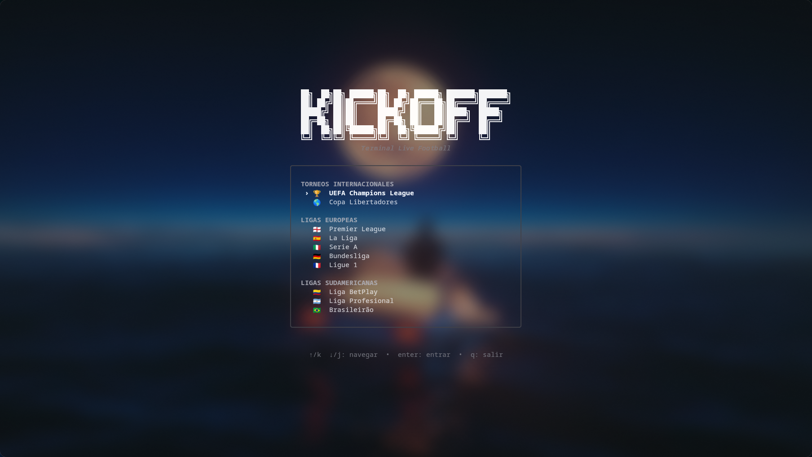
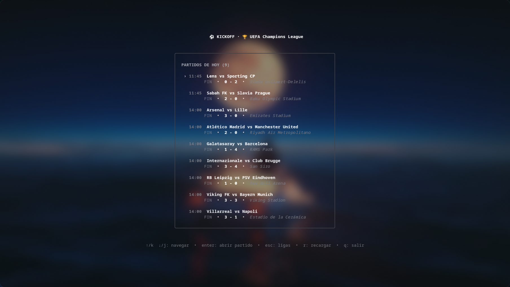
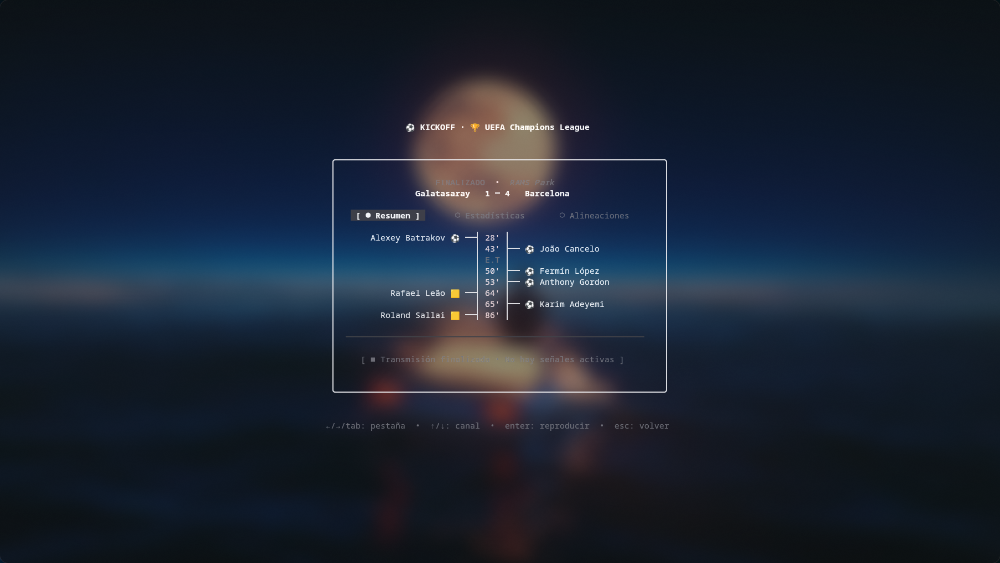
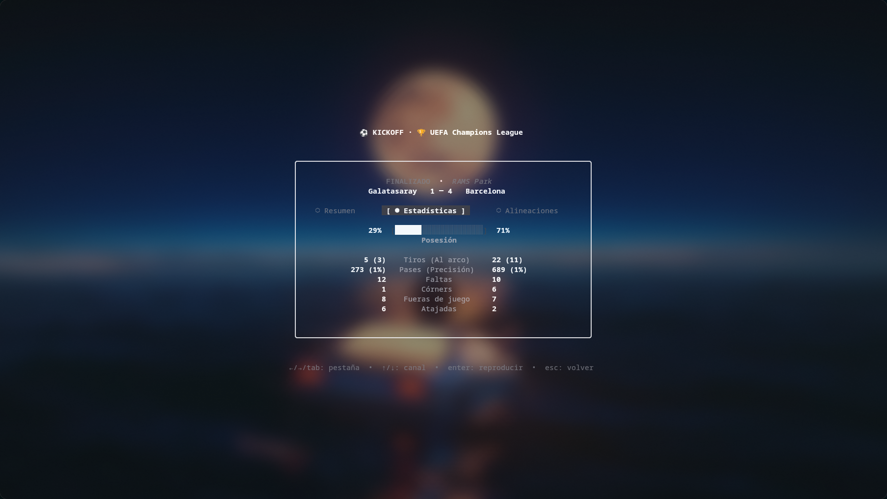
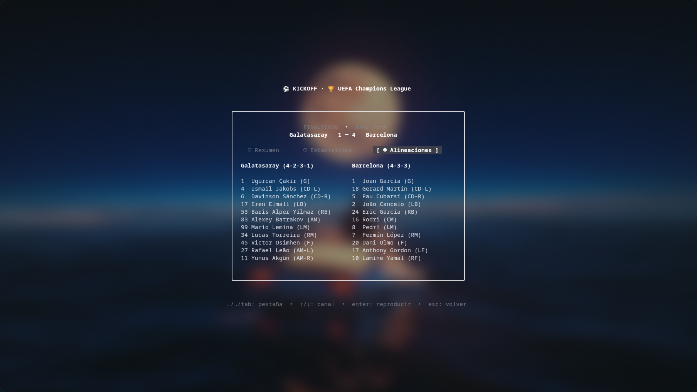

<div align="center">

# ⚽ kickoff

### An elegant, blazing-fast football TUI & live broadcast launcher for your terminal.

[](https://github.com/e12jassir/kickoff-cli/releases)
[](https://aur.archlinux.org/packages/kickoff-cli)
[](LICENSE)

<br/>

[Features](#-features) • [Screenshots](#-screenshots) • [Installation](#-installation) • [Keybindings](#-keybindings) • [Competitions](#-supported-competitions)

<br/>

</div>

---

## ⚡ Overview

**kickoff** brings the excitement of the stadium right to your terminal. Built with Charm's **Bubble Tea** and **Lip Gloss**, it delivers live scores, real-time match events, in-depth stats, and tactical lineups in a distraction-free keyboard-driven interface.

When it's match time, launch verified high-definition broadcast streams in hardware-accelerated **mpv** with a single keystroke. No browser tabs. No popups. No delays.

---

## 📸 Screenshots

<div align="center">

| 🏆 Competition Hub | 📅 Daily Fixtures & Live Pulse |
| :---: | :---: |
|  |  |

| ⏱️ Centered Event Timeline | 📊 Team Stats & Possession Bar |
| :---: | :---: |
|  |  |

| 📋 Tactical Lineups & Starting XI |
| :---: |
|  |

</div>

---

## ✨ Features

- **🎮 Keyboard-First Interface**: Fluid navigation with `hjkl` or arrow keys, modal overlays, and instant tab jumps.
- **🔴 Live Event Telemetry**: Dynamic match clock, live score indicators, and a centered vertical timeline tracking goals, penalties, cards, and substitutions.
- **📊 In-Depth Analytics**: Live possession bars, shot distribution, passing accuracy, corner kicks, and discipline metrics.
- **🛡️ Starting XI & Formations**: Full tactical rosters, squad numbers, and substitute benches.
- **📺 Zero-Ad Stream Launcher**: Automatically maps fixtures to verified broadcast signals and launches them smoothly in `mpv`.
- **⚡ Background Health Prober**: Probes live playlists asynchronously in the background with zero UI blocking.

---

## 🚀 Installation

### Arch Linux (AUR)
```bash
yay -S kickoff-cli
# or
paru -S kickoff-cli
```

### Go Install
```bash
go install github.com/e12jassir/kickoff/cmd/kickoff@latest
```

### Prebuilt Binaries (Linux / macOS)
Download the latest precompiled release for your architecture from the [Releases](https://github.com/e12jassir/kickoff-cli/releases) page:

```bash
tar -xzf kickoff_*_linux_amd64.tar.gz
sudo mv kickoff /usr/local/bin/
```

### Build from Source
```bash
git clone https://github.com/e12jassir/kickoff-cli.git
cd kickoff-cli
make install
```

> **Requirement:** [`mpv`](https://mpv.io/) must be installed on your system to launch video streams.

---

## ⌨️ Keybindings

| Key | Action |
| :--- | :--- |
| `↑` / `k` · `↓` / `j` | Move selection |
| `Enter` | Open match modal / Launch selected channel |
| `1` / `2` / `3` | Switch modal tabs (Timeline / Stats / Lineups) |
| `←` / `h` · `→` / `l` | Previous / Next tab |
| `r` | Refresh live scores & fixtures |
| `Esc` / `Backspace` | Back to menu / Close modal |
| `q` / `Ctrl+C` | Quit |

---

## 🏆 Supported Competitions

- **International**: UEFA Champions League, Copa Libertadores
- **Europe**: Premier League, La Liga, Serie A, Bundesliga, Ligue 1
- **South America**: Liga BetPlay (Colombia), Liga Profesional (Argentina), Brasileirão (Brazil)

---

## 📄 License

MIT © [Esteban David Marrugo Jassir](https://github.com/e12jassir)
