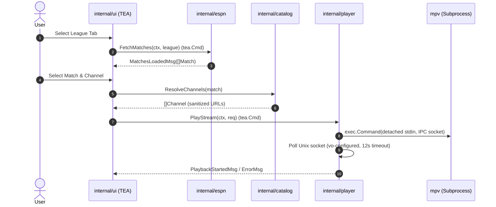

# Technical Design: Migrate to Bubble Tea

## Technical Approach
Replace the legacy Bash, Python, and fzf scripts with a native Go 1.27 binary (`github.com/e12jassir/kickoff`). The core architecture uses Charm's Bubble Tea framework (The Elm Architecture) to manage terminal state, rendering, and asynchronous side-effects (`tea.Cmd`). ESPN scoreboards are parsed defensively using Go's standard library and cached with a 300-second TTL. Stream resolution isolates protocol sanitization, while an MPV supervisor controls playback via a dedicated Unix IPC domain socket without taking over terminal `stdin`.

## Architecture Decisions
- **ADR-1: Bubble Tea (TEA) Event Loop**: Replaces shell pipelines with a purely functional model/view/update cycle. Network fetches and player launches run as non-blocking `tea.Cmd` background routines, avoiding terminal redraw glitches.
- **ADR-2: Detached Process & Unix IPC Telemetry**: MPV runs with `--no-terminal`, `--input-terminal=no`, and `stdin` bound to `/dev/null`. IPC synchronization connects to a unique socket to wait for `vo-configured` (up to 12s timeout) before handing control back.
- **ADR-3: In-Memory TTL Cache with Disk Persistence**: Fixtures are cached per league for 300s using JSON files under `$XDG_CACHE_HOME/kickoff/` to prevent ESPN endpoint throttling.
- **ADR-4: BoldMSS Protocol Sanitizer**: BoldMSS CDN endpoints are sanitized from HTTPS to HTTP to prevent upstream FFmpeg TLS handshake decoding failures observed in MPV.

## Data Flow


## File Changes
- `go.mod`, `go.sum`: Go 1.27 module initialization with Bubble Tea, Bubbles, and Lip Gloss.
- `cmd/kickoff/main.go`: Application entrypoint, CLI flags, Bubble Tea program runner.
- `internal/model/model.go`: Domain models (`Match`, `Competitor`, `Channel`, `League`).
- `internal/espn/client.go`: HTTP client, scoreboard JSON unmarshaler, 300s TTL cache.
- `internal/catalog/catalog.go`: League/team channel registry, match regex matcher, BoldMSS protocol sanitizer.
- `internal/player/player.go`: MPV supervisor, isolated Unix IPC socket client, buffer flags.
- `internal/ui/ui.go`: Bubble Tea model, update/view handlers, tab/list keymaps, Lip Gloss styles.
- `Makefile`: Update build (`go build -o bin/kickoff ./cmd/kickoff`) and test targets.

## Interfaces/Contracts
```go
package espn
type Client interface {
    FetchMatches(ctx context.Context, leagueCode string) ([]model.Match, error)
}

package catalog
type Resolver interface {
    GetChannels(match model.Match) []model.Channel
}

package player
type Controller interface {
    PlayStream(ctx context.Context, req model.PlayRequest) error
}
```
Domain types in `internal/model`:
- `Match`: ID, Title, HomeTeam, AwayTeam, StartTime, Venue, Status, League.
- `Channel`: Name, URL, Resolution, BitrateMode (`min` | `max`).

## Testing Strategy
- **Unit Testing**:
  - `internal/espn`: Mock ESPN responses via `net/http/httptest` covering valid scoreboards, empty fixtures, and corrupted JSON.
  - `internal/catalog`: Table-driven tests validating regex matching for clubs (e.g., Real Madrid, Barcelona) and HTTP sanitization.
  - `internal/player`: Mock Unix socket listener verifying handshake, `vo-configured` parsing, and exit timeout paths.
- **TUI State Testing**:
  - `internal/ui`: Test `Update` transitions for tab navigation, empty list rendering, and error messages.

## Threat Matrix
| Threat | Impact | Mitigation |
| :--- | :--- | :--- |
| **Terminal Stdin Capture** | MPV hijacks stdin, freezing or corrupting TUI state | Spawn MPV with `cmd.Stdin = nil` (`/dev/null`), `--no-terminal`, and `--no-input-terminal`. |
| **IPC Socket Collision / Tampering** | Collision in shared `/tmp` or unauthorized socket access | Generate sockets in dedicated `0700` directories via `os.MkdirTemp` with PID/timestamp tokens. |
| **Command Injection** | Malicious stream URLs or match titles execute arbitrary commands | Never invoke shell (`sh -c`). Execute binary directly via `exec.Command` with discrete arguments; validate URLs with `net/url`. |
| **Orphaned Socket / Process Leak** | Leaked socket files or zombie MPV instances on crash | Defer directory cleanup in `player.Controller`; terminate pre-existing kickoff MPV processes before launch. |

## Migration/Rollout
1. Initialize Go module and implement core packages (`model`, `espn`, `catalog`, `player`).
2. Implement `internal/ui` and wire TEA program in `cmd/kickoff/main.go`.
3. Update `Makefile` build targets to output `bin/kickoff`.
4. Validate live HLS playback across all 10 leagues against existing bash behavior.
5. Deprecate legacy `bin/kickoff` and `bin/kickoff-preview`.
*Rollback*: Git revert `Makefile` and restore original bash scripts.

## Open Questions
- Should team badge rendering (Kitty ICAT / Chafa) be ported natively or provided via an optional detail pane?
- Should custom user stream overrides be supported via a `config.json` file in `$XDG_CONFIG_HOME/kickoff`?
